


 


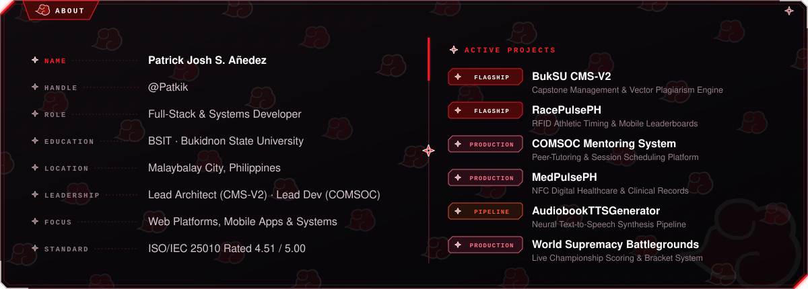

  

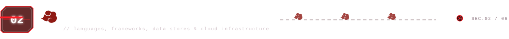


  

  <a href="https://github.com/Patkik/CMS-V2"></a>
  <a href="https://github.com/Patkik/RacePulsePH"></a>

  <a href="https://github.com/Patkik/Monitoring-Information-Systems"></a>
  <a href="https://github.com/Patkik/MedPulsePH"></a>

  <a href="https://github.com/Patkik/AudiobookTTSGenerator"></a>
  <a href="https://github.com/Patkik/World-Supremacy-Battleground-app"></a>

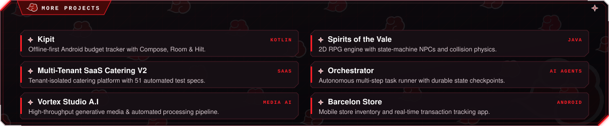

  

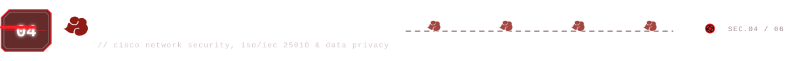

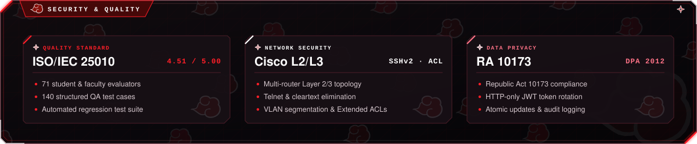

  

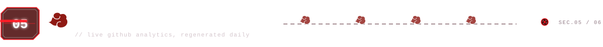



  

  
  

  
  

  

